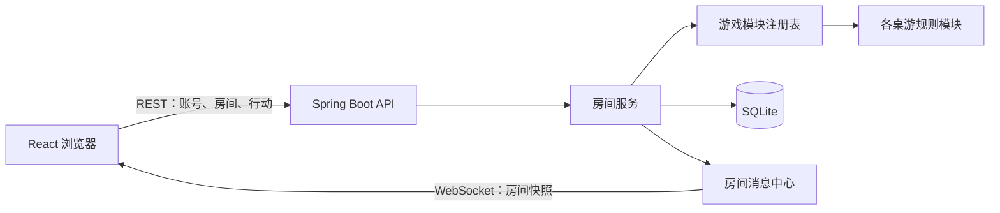

# FORTELL BOARDGAME

轻量级在线桌游平台。玩家可以注册账号、创建或加入房间，并通过浏览器与其他玩家实时对局。项目采用前后端分离架构，游戏规则由服务端模块处理，房间状态通过 WebSocket 同步。

## 项目亮点

- **多人房间与实时同步**：支持创建房间、加入房间、座位管理和游戏配置；房间状态由后端维护，并实时推送给房间成员。
- **可扩展的游戏模块**：游戏实现遵循统一的 `GameModule` 接口，由模块注册表按游戏类型分发配置、开局和行动处理逻辑。
- **规则在服务端校验**：客户端提交行动，后端验证玩家身份、回合和行动合法性，再更新并广播房间状态。
- **完整的账号流程**：支持注册、登录、验证码、登出、个人资料和密码管理；网页与 WebSocket 使用同一 Session 登录态。
- **专门的伯明翰对局界面**：工业革命：伯明翰包含地图、市场、玩家面板与行动控制，并由服务端处理建造、出售、研发、运输网、贷款和侦查等行动。

## 游戏列表

| 游戏 | 人数 | 玩法简介 |
| --- | ---: | --- |
| 工业革命：伯明翰（Brass: Birmingham） | 2–4 | 工业网络策略游戏，围绕产业建设、运输、市场和资源规划展开。 |
| 印加宝藏（Incan Gold） | 2–8 | 玩家共同探险，在继续深入与带着收获返回之间作出选择。 |
| 狂野骆驼：卡牌版（Camel Up: The Card Game） | 2–6 | 使用卡牌版规则参与骆驼竞速与下注。 |
| 环中物语（Things in Rings） | 2–6 | 主持人持有隐藏规则，其他玩家根据提示推理词语应放入的区域。 |
| 猜拳（RPS） | 2–8 | 可选择大乱斗或淘汰赛模式。 |

代码中还包含五子棋模块；目前游戏目录接口暂不公开该入口。

## 技术栈

| 部分 | 技术 |
| --- | --- |
| 前端 | React 18、Vite、React Router |
| 后端 | Java 21、Spring Boot 4、Spring WebSocket |
| 数据存储 | SQLite、Spring JDBC |
| 实时通信 | WebSocket（房间消息）与 REST API（账号、房间及游戏行动） |
| 登录态 | HttpSession Cookie |

## 快速开始

### 环境要求

- JDK 21 或更新版本
- Node.js 18 或更新版本，以及 npm

### Windows 一键启动

在项目根目录运行：

```powershell
.\start-dev.cmd
```

脚本会分别打开后端和前端终端；首次运行前端时会自动安装依赖。浏览器访问 <http://localhost:5173>。后端默认监听 `8080`，Vite 会将 `/api` 和 `/ws` 请求代理到后端。

也可以手动启动服务（在两个终端分别运行）：

```powershell
cd backend
.\mvnw.cmd spring-boot:run
```

```powershell
cd frontend
npm install
npm run dev
```

macOS 或 Linux 同样在两个终端分别运行：

```bash
cd backend
./mvnw spring-boot:run
```

```bash
cd frontend
npm install
npm run dev
```

默认地址：

- 前端：<http://localhost:5173>
- 后端：<http://localhost:8080>

后端默认使用 SQLite，数据库文件按启动工作目录创建。使用项目启动脚本时，后端工作目录为 `backend/`。

## 项目结构

```text
.
├── backend/
│   └── src/main/java/com/fortell/boardgame/
│       ├── controllers/       # 账号、游戏目录、房间 API
│       ├── game_modules/      # 各桌游规则模块
│       ├── repositories/     # SQLite 数据访问
│       ├── services/         # 账号与房间业务
│       └── websocket/        # 房间实时消息
├── frontend/
│   └── src/
│       ├── components/       # 页面框架与通用组件
│       ├── features/rooms/   # 房间会话、命令与通用布局
│       ├── games/            # 各游戏设置和对局界面
│       └── pages/            # 登录、大厅、游戏目录、账号等页面
├── scripts/                  # Windows 开发启动脚本
├── DEPLOYMENT.md             # Linux + Nginx 部署说明
└── README.md
```

## 游戏模块与房间流程

后端通过 `GameModule` 统一各游戏的配置清理、开局校验、初始状态和行动处理；`GameModuleRegistry` 根据房间的游戏类型找到对应模块。房间服务负责成员、座位和房间状态，WebSocket 将服务端产生的房间快照发送给在线成员。



## 部署

生产部署建议由 Nginx 提供前端静态文件，并将 `/api` 和 `/ws` 转发到 Spring Boot 服务。服务器准备、构建、Nginx 配置和更新步骤见 [DEPLOYMENT.md](DEPLOYMENT.md)。

当前配置面向单机部署；多实例房间同步需要额外的共享消息与状态方案。

## 开发命令

```bash
# 前端开发服务器
cd frontend && npm run dev

# 前端构建
cd frontend && npm run build

# 前端自动化测试
cd frontend && npm test

# 后端自动化测试
cd backend && ./mvnw test
```

Windows 后端测试命令为 `cd backend` 后运行 `.\mvnw.cmd test`。
